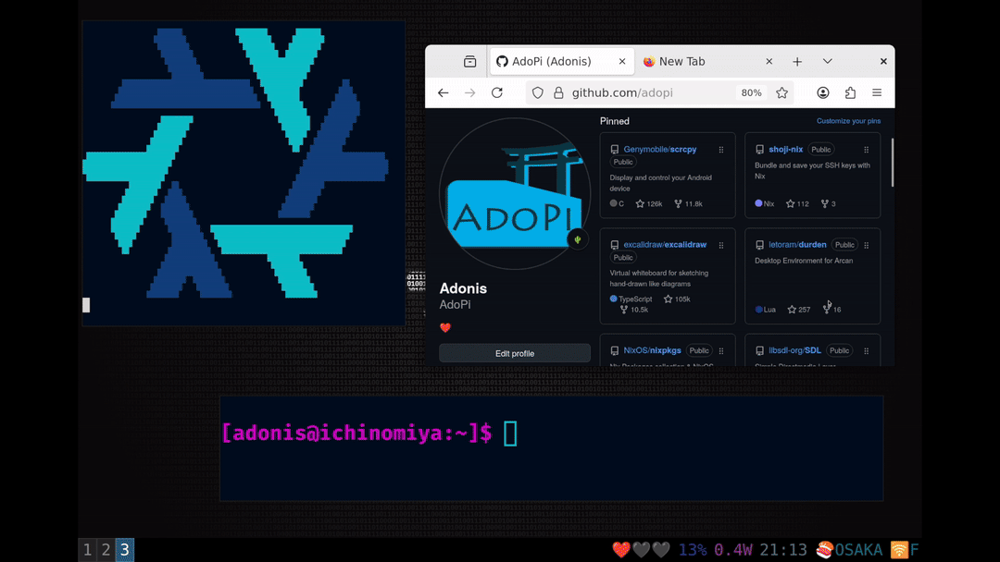

# Gameboy locker for Wayland

This project replaces the usual password screen with a Gameboy emulator running a patched Pokémon game!
To unlock your session, you have to solve a little challenge, kind of like a mini escape room built into your OS.

<a href="https://www.reddit.com/r/unixporn/comments/1mmhb85/oc_i_play_pokémon_to_unlock_my_wayland_session/">
</a>
<a href="https://news.ycombinator.com/item?id=44854686">
</a>

## Unlock your session with fun!
I've been a Linux enthusiast since I was a kid. What always captivated me was the freedom to customize my system exactly the way I wanted. With Wayland, we've reached an incredible level of performance. It's like turning your operating system into a video game! I've always been fascinated by the blend of fun and the serious, technical nature of an OS. That’s what inspired me to create this project.

I started by studying Wayland, its protocol and how to build a compositor. Then I became particularly intrigued by the concept of a locker, which reminded me a bit of an escape game. That’s when I thought: how cool would it be to solve a puzzle to unlock your session, instead of just typing a password? Since I’ve worked with emulators in the past and I’m a huge Pokémon fan, the idea of building the puzzle around that game came to me instantly!

I've got plenty more ideas, see you around!

## Solve this puzzle
⚠️ Spoilter alert ⚠️ 

As this is a puzzle game: the Pokémon party in the menu is hidden, you need to click on the radio to activate it.
Then you can set the good password to unlock your session!

## Readme

This project uses ext-session-lock-v1 protocol, you need a compositor which implements this protocol to use this project (sway is fine).

Warning! This project is very experimental! Even if I use it regularly, it is only a proof of concept. Use it at your own risk!

The development Escape shortcut still unlocks the session without solving the puzzle. A fixed puzzle is not strong authentication; do not use this prototype as a security boundary.

You need to have a compatible game, I provide a little patch to patch the project from https://github.com/pret/pokecrystal.
Edit this patch to set your own password!

You need to be on this commit: 961fad9e1, then you can apply the patch provided on this repo

``` patch -p1 < crlock.patch ```

It will apply the patch that provide a way for the emulator to know when it can unlock your session (in addition to some nice mods made by myself: skip intro, no popup menu in pokémon party).

After applying this patch, you need to compile the game.

Rebuild both the ROM and the locker when updating this patch. Older patched ROMs signal success at `0xDCC7`; they are not compatible with the current locker, which reads `0xCFFF`.

Then, you can run this project by using nix to enter into a shell which builds this project
``` nix develop ```

Now, you are free to run this locker! 
```./build/wlgblock patched-game.gbc```

## How it works?

I have implemented a low level window in Wayland ( EGL + keyboard listeners ), this is the kind of job SDL or GTK usually do for you. 
I've been stucked with SDL3 for a long time, trying to use a raw wl_surface object without success, so I decided to implement my own window without any help of a higher level GUI.

It has given me the freedom of doing what I wanted with the Wayland objects I needed.

Once the window was done: I have added the ext-session-lock protocol to support locking and unlocking my session securely: even if the locker crashes, you can't unlock your session, thank you Wayland.

Then, I needed to hack an emulator to merge my window system into this emulator, I choose gbcc because it already supported multiple GUI backends ( SDL, GTK ).
I just added my wayland window as a new GUI backend and that's it, the Gameboy locker was done!
I'm not sure if it was necessary but I also converted the shaders to OpenGLES2 as Wayland seems to be compatible with GLES2 only.

Lastly, I've hacked the Pokémon Cristal game assembly to put my password logic into the game.
The ROM patch reserves one byte in fixed WRAM0 at `0xCFFF`, named `wLockerSolved`. The linker tracks this allocation and rejects overlapping sections. The game initializes it to zero at startup; the frontend also clears it before starting the emulation thread.

The patch compares the six Pokemon nicknames in order. Its comparison loop loads the expected character with `ld a, [de]` and compares it with `cp [hl]`, without a temporary B register. If all six names match, the game writes **99 decimal** (`0x63`) to `wLockerSolved`.

The Wayland frontend regularly reads `0xCFFF` from its own loop, not after every emulated CPU cycle. When it reads 99, it starts the unlock animation and requests `unlock_and_destroy` from the compositor.

### ROM regression test

On Linux with the project's compiler and library dependencies available, compare a previously patched ROM (the B-based comparison and DCC7 signal) with a ROM built from the current patch:

```sh
bash testing/test-locker-rom.sh old.gbc new.gbc old.sym new.sym
```

The test runs the assembled routines in the gbcc CPU core. It checks all 65,536 byte pairs, 1,024 string cases and all 720 party permutations. Only the expected order may write 99. The `.sym` files supply the routines' addresses and banks; the new flag must be reserved at `00:CFFF`. ROM files are not included in this repository.


## Thanks

Many thanks to 
- [GBCC](https://gbcc.github.io)
- [Pret-Crystal](https://github.com/pret/pokecrystal)


## License 

This project has a double license. The original project is under the MIT license but all modifications made to the code to transform this project into a locker are under the GPLv3 license.


